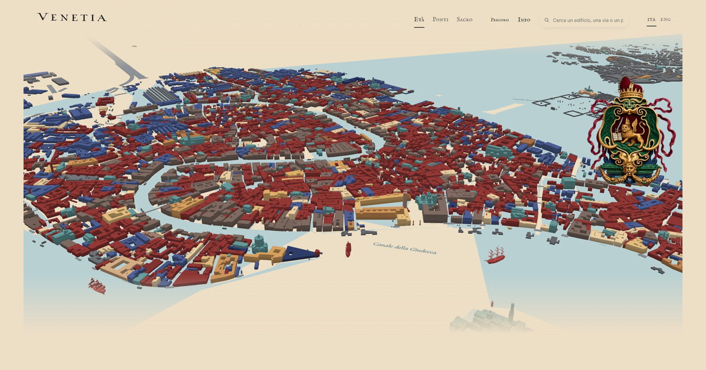

<div align="center">

# 🏛️ Venice, Building by Building


**A 3D atlas of Venice's historic centre: 11,137 buildings coloured by epoch, assembling through time**

<a href="https://venice-by-building.vercel.app">🌐 Live Site</a> · <a href="#-quick-start">Quick Start</a> · <a href="#-features">Features</a> · <a href="#-pipeline">Pipeline</a> · <a href="#-tech-stack">Tech Stack</a>



</div>

---

> Venice has no register of construction years. This atlas draws every building from OpenStreetMap footprints, dates it from the municipal VPRG classification and Italian Wikipedia, enriches it with Wikidata and Commons photographs, and lets you watch the city assemble itself — epoch by epoch, street by street, bridge by bridge.

## ✨ Features

🏗️ **11,137 buildings** with courtyards as holes, roof volumes as prisms, and measured heights from the 2010 topographic survey

🎨 **Coloured by epoch** — 3,642 pre-1800, 423 19th-century, 1,888 modern, 25 with exact year; 5,177 in unknown grey

🌐 **Trilingual** — Russian, Italian, English; switch in the top bar, `?lang=it` from a link, choice remembered

📸 **1,082 Commons photographs** — author and licence on every building card

🏛️ **1,536 Wikidata matches** by geometry — names, architects, styles, heritage status, dates

🧱 **Streets as ordered rows** of facades, with a side for each house

🌉 **465 bridges** with municipal characteristics, plus church walk and bridge visit routes

⏳ **Timeline** — watch the city assemble epoch by epoch

---

## 🚀 Quick Start

```bash
git clone https://github.com/maximosovsky/venice-by-building.git
cd venice-by-building/web
npx serve .
```

Open `http://localhost:3000` — the viewer runs with committed data, no build step.

<details>
<summary>🔄 Run the full pipeline</summary>

```bash
cd pipeline
python -m venice.s01_buildings island centro
python -m venice.s02_dating island centro
python -m venice.s04_wikimedia island centro
python -m venice.s05_streets island centro
python -m venice.s09_municipal centro
python -m venice.s10_itwiki centro
python -m venice.s11_media centro
python -m venice.s07_wikidata centro
python -m venice.s08_wikidata_enrich centro
python -m venice.s06_export centro
```

The pipeline writes GeoJSON/GeoParquet to `data/` first, then the viewer's binary tiles to `web/data/`. Source data lives in `data/raw/` — kept on disk, out of git. Run `node tests/i18n_coverage.mjs` to verify every visible text has all three languages.

</details>

<details>
<summary>🧪 Run the tests</summary>

```bash
node tests/i18n_coverage.mjs          # all texts in RU/IT/EN
node tests/worker_smoke.mjs           # viewer's worker on real tiles
python3 tests/test_viewer_contract.py  # data contract integrity
node tests/bridge_route_ui.mjs        # bridge route UI
```

</details>

---

## 🔄 Pipeline

Everything in `pipeline/venice/` writes plain GeoJSON/GeoParquet first and the viewer's binary format only at export — the data stays independent of the viewer.

| Stage | What it does | Output |
|---|---|---|
| `s01_buildings.py` | OSM extract: buildings, parts, addresses, streets, water | `data/processed/` |
| `s02_dating.py` | Municipal VPRG classification + OSM dates → evidence table | `evidence_<area>.csv` |
| `s04_wikimedia.py` | Wikidata labels, Wikipedia articles, Commons photos | `data/ready/wikimedia.json` |
| `s05_streets.py` | Streets as ordered rows of facades | `data/ready/streets.json` |
| `s07_wikidata.py` | Wikidata items matched to footprints by geometry | `data/processed/wikidata_match_*` |
| `s08_wikidata_enrich.py` | Names, articles, dates, architects, styles, heritage, heights | `data/ready/wikidata_enriched.json` |
| `s09_municipal.py` | Measured heights from 2010 topographic survey | `data/processed/municipal_heights_*` |
| `s10_itwiki.py` | Construction dates from Italian Wikipedia prose | `data/processed/itwiki_dates_*` |
| `s11_media.py` | Commons photos fetched, shrunk to 560 px WebP | `web/media/` |
| `s06_export.py` | Tiles, packs, attributes, cards, labels → viewer format | `web/data/` |

> [!NOTE]
> `pipeline/venice/periods.py` holds the epoch table and state flags from municipal class descriptions. Nothing there may be turned into a single year: the atlas carries intervals, never invented years.

---

## 🏗️ Tech Stack

| Layer | Technology |
|---|---|
| Pipeline | Python 3.12, GeoPandas, Shapely, PyArrow |
| Viewer | Three.js r186 (SydMap engine), vanilla JS |
| Hosting | Vercel (static, no backend) |
| Data sources | OpenStreetMap (ODbL), VPRG Città Antica (CC BY 4.0), Wikidata (CC0), Wikipedia (CC BY-SA) |

<details>
<summary>📁 Repository layout</summary>

```
venice-by-building/
├── pipeline/venice/     data pipeline (ours, MIT)
├── web/                 the site: viewer code, generated data, fonts, vendored three.js
│   ├── data/            viewer binary tiles
│   ├── media/           Commons photos (WebP)
│   ├── models/          3D ship models
│   ├── img/             static images
│   └── vendor/          SydMap + three.js (MIT)
├── data/
│   ├── raw/             source data (on disk, out of git)
│   ├── processed/       intermediate pipeline output
│   └── routes/          bridge and church routes
├── docs/                engine audit, VPRG docs, data inventories
├── research/            engine source snapshots, provenance records
├── reports/             performance baselines, municipal audits
├── tests/               contract, i18n, UI tests
└── scripts/             ground cache, ship compression
```

</details>

---

## 🗺️ Roadmap

- [x] Building geometry, parts, epochs, heights
- [x] Wikimedia cards with photographs, architects, heritage
- [x] Trilingual interface (RU/IT/EN)
- [x] Bridge routes with municipal characteristics
- [x] Church walks (Sacred Walk phases)
- [x] Streets as ordered facade rows
- [x] Address enrichment from municipal data
- [x] Timeline animation
- [ ] Historical register integration (1740/1808/1857)
- [ ] Topographic releases 1987–2010 3D data
- [ ] TimeMachine Atlas semantic date extraction

---

## 🤝 Contributing

Fork → `feature/name` → PR. Tests must pass: `node tests/i18n_coverage.mjs` ensures every visible text has all three languages.

---

## 📄 Licence

| Material | Licence |
|---|---|
| Pipeline, site content, enrichment data | MIT |
| OpenStreetMap geometry | ODbL 1.0, © OpenStreetMap contributors |
| VPRG Città Antica classification | CC BY 4.0, Comune di Venezia |
| Wikidata | CC0 |
| Wikipedia text | CC BY-SA |
| Wikimedia Commons photos | Per file — author and licence on each card |
| SydMap viewer, three.js | MIT |

[Maxim Osovsky](https://linkedin.com/in/osovsky). Pipeline and site content licensed under [MIT](LICENSE).